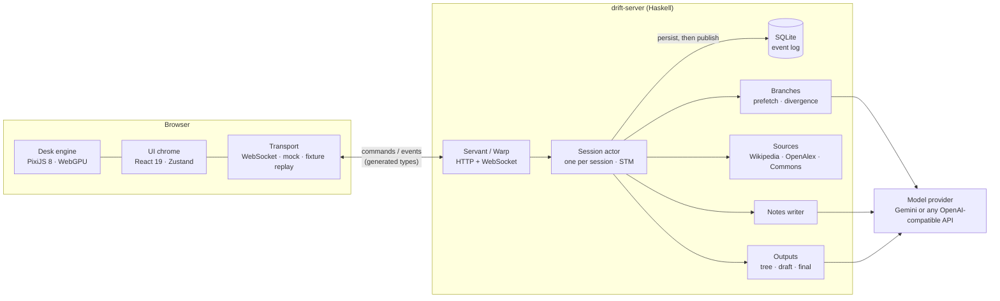

<div align="center">

# Driftwords

**A thinking workbench where you explore by choosing, not chatting.**

[](https://github.com/Bill092738/drift_words/actions/workflows/ci.yml)
[](LICENSE)


Built at **HackOHI/O 2026** (Open Track).

</div>

## Team

**Team #56: MyGO**

| Member | Discord username |
| --- | --- |
| Bill Zhao (team lead) | `billzhao4` |
| bellayanovo | `bellayanovo` |
| LordofChaos | `lordofchaos9559` |

---

Driftwords is a browser-based tool for the moments when you want to do something but don't know what, or have a vague direction you can't untangle. Instead of a blank prompt, you get an infinite desk of drifting words. You pick the one that interests you most, it grows a ring of related words, and you pick again. Your path becomes a tree, sources quietly land on the desk behind the words they explain, and a sidebar turns the path into structured, cited notes. When you're done, you leave with a decision tree, a full draft and a final document.

Language models and web search run in the background. **You never talk to an AI.**

## Contents

- [How it works](#how-it-works)
- [Features](#features)
- [Quick start](#quick-start)
- [Architecture](#architecture)
- [Technical highlights](#technical-highlights)
- [Configuration](#configuration)
- [Development](#development)
- [Project structure](#project-structure)
- [Limitations](#limitations)
- [Documentation](#documentation)
- [License](#license)

## How it works

1. **Drift.** A cloud of words floats on an infinite desk. There is no prompt box.
2. **Pick.** Choose the word that pulls at you. The camera glides to it and a ring of related words grows around it.
3. **Steer.** A divergence slider sets how far the next ring strays, measured in embedding space. Click any earlier word to backtrack, or type a single word to go somewhere new.
4. **Collect.** Papers, web pages, images and audio land on the desk behind the words they explain. A sidebar writes one cited note for every step of your path; promote the notes that matter and strike the ones that don't.
5. **Wrap up.** Driftwords turns the tree, the notes and the citations into a decision tree, a draft and a final document, with Markdown, HTML and Word downloads.

## Features

- **Choice-only interaction.** The only typing is a single word, never a sentence.
- **A custom 2D engine.** A WebGPU desk (WebGL2 fallback) with spring-based motion and spatial-index culling and hit testing.
- **Model-agnostic AI slot.** Any OpenAI-compatible endpoint, local or hosted. The demo runs on Gemini: a lite model on the latency-critical path, a larger one for background writing.
- **Speculative prefetch.** After each ring, the next ring of every offered word is generated in parallel, so a pick usually finds its answer ready (60 to 150 ms against about 1.5 s for a miss).
- **Real, verifiable sources.** Wikipedia, OpenAlex and Wikimedia Commons, with exact metadata from doi.org and APA references rendered by `citeproc`. References never come from the model.
- **Save, resume and replay.** Every session is an append-only event log in SQLite. Reload the page or restart the server, and the desk comes back exactly as it was.
- **Accessible by design.** Word list view, high contrast, larger text and reduced motion switches.
- **Runs offline.** Without a model or network, the backend falls back to a deterministic vocabulary and template notes, and the frontend runs entirely on an in-browser mock.

## Quick start

**Prerequisites:** GHC 9.10 and cabal 3.16 (via [ghcup](https://www.haskell.org/ghcup/)), Node.js 24 and pnpm. System libraries are listed in the build notes under [Development](#development).

```bash
git clone https://github.com/Bill092738/drift_words.git
cd drift_words
make frontend-install

# Try the interface with no backend at all (in-browser mock session):
make dev                     # http://localhost:5173

# Or run the full demo on Gemini:
cp .env.example .env         # then set GEMINI_API_KEY (https://aistudio.google.com/apikey)
make demo                    # http://localhost:8080/?live
```

`make demo` builds the frontend and starts `drift-server` with [`backend/config.gemini.yaml`](backend/config.gemini.yaml). The server checks the key at startup and stops with a clear message if it is wrong. `.env` is gitignored; never commit a key.

## Architecture



| Layer | Technology |
| --- | --- |
| Desk rendering | TypeScript, PixiJS v8 (WebGPU with WebGL2 fallback), spring-based motion, R-tree spatial index |
| UI chrome | React 19, Zustand (sidebar, controls, outputs) |
| Protocol | Contract-first: Haskell types in `Protocol.hs` generate the TypeScript types and replay fixtures |
| Backend | Haskell: Servant/Warp, STM, async, an event-sourced domain stored as a persistent linked list |
| AI | A model-agnostic provider slot with a priority scheduler, speculative prefetch and embedding-based divergence |
| Sources and citations | Wikipedia (web pages), OpenAlex (papers and open-access PDFs), Wikimedia Commons (images and audio); CSL-JSON metadata and APA references via `citeproc` |
| Outputs | Decision tree, draft and final document as Markdown, with HTML and Word (DOCX) exports from a built-in exporter |
| Persistence | SQLite event log (save, resume, replay) |

See [TECH_ROADMAP.md](TECH_ROADMAP.md) for the reasoning behind each choice.

## Technical highlights

- **Event sourcing with persist-before-publish.** Each session is a single serialized actor. It validates commands and background results, writes each event batch to SQLite, and only then publishes it, so clients never see state that a crash could lose. A child-process test runs the real server three times against one database and checks that each run replays and continues the same session.
- **Contract-first protocol.** The wire types live once, in Haskell. `make protocol` generates the TypeScript types and the fixtures, and CI fails if either drifts from the source.
- **Latency budget.** Model work runs through a priority scheduler in which the pick the user is waiting on pre-empts lower-priority jobs. Prefetch and a fast model keep picks interactive; notes, sources and the final rewrite run off the critical path and arrive quietly.
- **Divergence in embedding space.** Candidates are embedded and selected from a band of distances from the current word, so "near" and "far" mean something measurable.
- **Grounded citations.** Sources are retrieved, scored for relevance and resolved to CSL-JSON; the model may cite only keys it was given, and unknown keys are dropped.
- **A purpose-built engine.** The desk engine culls and hit-tests through a spatial index and animates with springs, behind a small API with its own playground at `/playground`.
- **Graceful degradation.** Every model and network dependency has a deterministic fallback, so the whole app, its tests and CI run with no key and no network.

## Configuration

Settings are read from the environment. The Makefile and `start.sh` also load a local `.env` (copy [.env.example](.env.example)).

| Variable | Default | Purpose |
| --- | --- | --- |
| `GEMINI_API_KEY` | unset | Key for `kind: gemini` providers |
| `DRIFT_CONFIG` | unset (offline vocabulary) | Model configuration, relative to `backend/`, for example `config.gemini.yaml` |
| `DRIFT_PORT` | `8080` | HTTP port |
| `DRIFT_DB_PATH` | `drift.sqlite` | SQLite event log, relative to the server's working directory |
| `DRIFT_STATIC_DIR` | `../frontend/dist` | Built frontend to serve |
| `DRIFT_SOURCES` | on | `0` turns source search off (for example with no network) |
| `DRIFT_WRITING` | on | `0` disables note production |
| `DRIFT_PREFETCH` | on | `0` disables speculative prefetch to save model calls |
| `OPENALEX_API_KEY` | unset | Raises the OpenAlex daily budget (free) |
| `DRIFT_LIVE_TESTS` | unset | `1` enables the opt-in, non-gating live source smoke test |

A model configuration maps **roles** to providers. `branches` generates the rings; `embeddings`, `cloud`, `writing` and `final` are optional. The demo configuration routes them like this:

| Role | Model | Why |
| --- | --- | --- |
| `branches`, `cloud` | `gemini-3.1-flash-lite` | about 1.4 s per answer; rings and the cloud are on the critical path |
| `writing` | `gemini-3.8-flash` | writes the sidebar notes in the background (1.5 to 12 s each, one call per pick) |
| `final` | `gemini-3.8-flash` | rewrites the final document; falls back to the kept notes' text on failure |
| `embeddings` | `gemini-embedding-001` | divergence band; about 0.5 s per ring |

See [`backend/config.example.yaml`](backend/config.example.yaml) for a local OpenAI-compatible server such as Ollama or llama.cpp.

<details>
<summary><strong>Provider options and Gemini specifics</strong></summary>

`kind: gemini` is Gemini's OpenAI-compatible endpoint with the settings Gemini 3 needs: `reasoning_effort: low` (Gemini 3 cannot stop thinking, and 3.8 Flash rejects `minimal`), no `temperature`, no output-token limit (Gemini counts thinking tokens against it, so a small limit returns an empty answer), and parallel prefetch. Every provider accepts these as options: `reasoning_effort`, `send_temperature`, `limit_output_tokens`, `timeout_seconds` and `concurrent_requests`.

To put 3.8 Flash behind the rings too, set `branches: gemini` in `config.gemini.yaml`. Expect a 4 to 10 s wait whenever a pick misses the prefetch (the first pick, a backtrack, a typed word).

Prefetch makes about 12 extra requests per pick (6 rings and 6 embedding calls). Notes add one 3.8 Flash request per pick; remove the `writing` role to go back to template notes.

</details>

<details>
<summary><strong>Backend behavior in detail</strong></summary>

**Sessions.** Create a session with `POST /api/sessions` and the JSON body `{"lang":"en"}`; the response is `{"sessionId":"..."}`. Connect to `/api/sessions/<sessionId>/ws`. `/api/health` returns plain-text `ok`. `GET /api/sessions/:id/export/{tree,draft,final}/{md,html,docx}` serves the outputs.

**Offline vocabulary.** Without `DRIFT_CONFIG`, the backend uses a fixed initial word cloud and six branch words, each with the selected node ID appended, so sessions can continue at any depth without a model.

**Notes.** Each non-root edge gets one note. With a `writing` role, the model writes a short relation and a one- or two-sentence explanation, citing the edge's sources by key; unknown keys are dropped. The note waits up to 3 s for the edge's sources, a failed call is retried once, and a second failure falls back to the template `fromWord → toWord`. Notes arrive quietly: the sidebar stays closed until opened. Promote, strike and restore are persisted.

**Sources.** Each non-root edge draws two kinds of material by weight (image 0.35, web page 0.25, paper or PDF 0.25, audio 0.15) and searches only the matching providers. The draw is seeded from the edge's words, so an edge keeps its mix across restarts. When the drawn kinds leave places free, the other keyless providers fill them; OpenAlex is never asked as a fallback. The server shares one HTTP cache and rate-limit environment, runs at most two edge searches with sixteen pending jobs, and skips the newest search with a warning when that queue is full. Writing waits for search completion or 250 ms, whichever comes first; later sources revise the note's citations. Search failures and empty results are normal and do not stop exploration. See [source behavior and limits](backend/sources/README.md).

**Wrap-up.** The outputs wait up to 30 s for notes still being written, so the note for the last pick reaches the draft and the final document. The final document keeps every note that is not struck; promoted notes are marked as important for the model.

**Privacy of keys.** Startup reports modes and whether an OpenAlex key is present, never the key value. HTTP diagnostics redact `api_key` values.

</details>

## Development

| Task | Command |
| --- | --- |
| Everything CI runs | `make check` |
| Regenerate TS types and fixtures | `make protocol` |
| Backend server on :8080 | `make server` |
| Whole app from the backend on :8080 | `make app`, then open `/?live` |
| The Gemini demo | `make demo`, then open `/?live` |
| Frontend dev server (proxies `/api` to :8080) | `make dev` |
| Backend and frontend together | `./start.sh` (Linux/macOS) or `start.cmd` (Windows) |
| Backend tests only | `cd backend && cabal test` |
| Real server-restart persistence test | `make backend-restart-test` |
| Frontend tests only | `cd frontend && pnpm test` |

Useful URL parameters:

| URL | Effect |
| --- | --- |
| `/` | In-browser mock session, no backend needed |
| `/?live` | A new live session on `drift-server`; its id is kept in the URL (`?session=...`) so a reload resumes it |
| `?dev` | Developer mode: switch between live, mock and fixture replays, restart, diagnostics and raw server messages |
| `?view=log` | The raw event log |
| `?debug=1` | Exposes `window.__desk.debugTiles()` and `debugSources()` for end-to-end tests |
| `/playground` | The desk engine playground |

**Testing.** CI builds and tests the backend (Hspec and QuickCheck), checks that the generated TypeScript and fixtures are up to date, then typechecks, tests (Vitest) and builds the frontend. The tests always start the server with `DRIFT_SOURCES=0` and no model, using saved responses, injected fakes and a fake-source child process, so CI never calls a model or a source API. These checks establish behavior, not model quality or real-provider availability.

<details>
<summary><strong>Build notes</strong> (verified on Ubuntu 26.04 with GHC 9.10.3)</summary>

- `cabal.project` needs `constraints: zlib +bundled-c-zlib, string-interpolate < 1`. The first builds zlib from bundled C sources, so `zlib1g-dev` is not required. The second works around an `aeson-typescript` build failure with `string-interpolate` 1.0.
- GHC links against `libgmp`, `libffi` and `libtinfo`, so install `libgmp-dev libffi-dev libncurses-dev`. Without sudo, symlinks to the runtime libraries (for example `libgmp.so -> libgmp.so.10`) in a directory on `LIBRARY_PATH` work as a substitute.

</details>

## Project structure

```text
.
├── protocol/              # Shared command/event contract notes and replay fixtures
├── backend/               # Haskell: drift-server and tools
│   ├── app/               # Executables: server, TS generator, branch and source CLIs
│   ├── src/Drift/
│   │   ├── Protocol.hs    # Source of truth for the wire format
│   │   ├── Domain/        # Pure session state, decisions and notes
│   │   ├── Server/        # Session actor and WebSocket handling
│   │   ├── Store/         # SQLite event log
│   │   ├── Model/         # Provider slot, scheduler, OpenAI-compatible client
│   │   ├── Pipeline/      # Cloud, branches, prefetch, sources, writing
│   │   ├── Search/        # Wikipedia, OpenAlex, Wikimedia Commons
│   │   ├── Sources/       # CSL metadata, DOI resolution, relevance
│   │   └── Output/        # Decision tree, draft, final document, exports
│   ├── test/              # Hspec and QuickCheck suites
│   └── config.*.yaml      # Model configurations
├── frontend/              # TypeScript client
│   └── src/
│       ├── engine/        # The desk rendering engine (PixiJS)
│       ├── desk/          # Desk content: words, rings, sources
│       ├── chrome/        # React UI: sidebar, controls, outputs
│       ├── motion/        # Spring-based motion
│       ├── transport/     # WebSocket, mock server and fixture replay
│       ├── store/         # Client state
│       └── protocol/      # Generated types (do not edit)
└── docs/                  # Demo script
```

## Limitations

- Sessions are English only, and source relevance uses an English word-overlap heuristic rather than model judgement.
- Crossref and arXiv are not searched directly: Crossref metadata arrives through doi.org, and arXiv PDFs can arrive as OpenAlex open-access links. Fixture references to those providers are recorded UI test data, not evidence of live provider support.
- Without an OpenAlex key, every machine behind one IP address shares a small daily budget of paper searches.

## Documentation

| Document | Contents |
| --- | --- |
| [idea.md](idea.md) | Product concept: design principles, interaction, data structures, open questions |
| [TECH_ROADMAP.md](TECH_ROADMAP.md) | Architecture, frontend/backend contract and milestones |
| [protocol/README.md](protocol/README.md) | How to change the protocol and regenerate its artifacts |
| [backend/sources/README.md](backend/sources/README.md) | Source providers, behavior and limits |
| [docs/DEMO.md](docs/DEMO.md) | The 3-minute demo script |

## License

[MIT](LICENSE) © 2026 Bill Zhao
