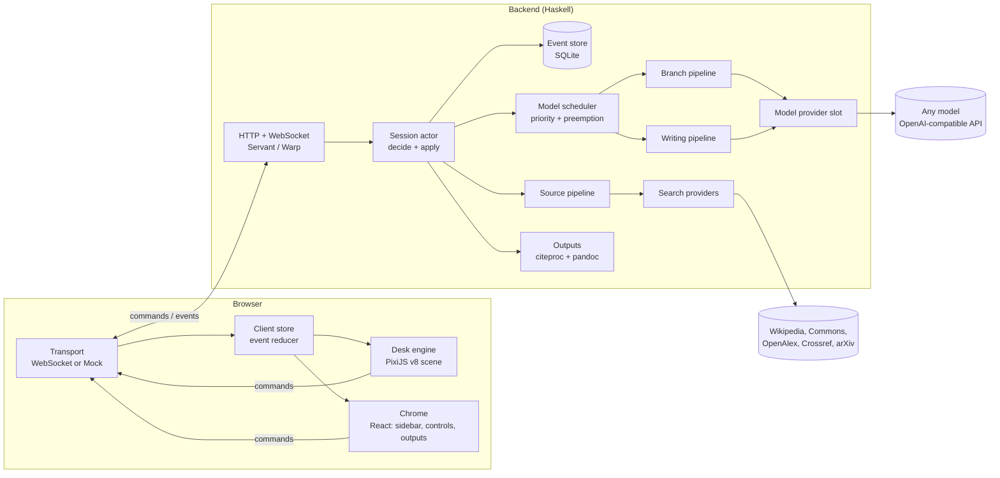
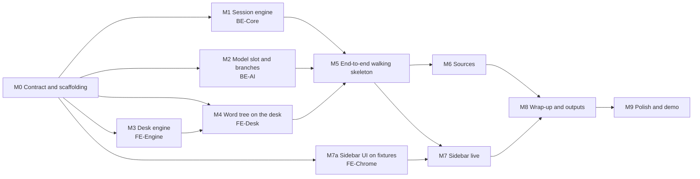

# Driftwords: Technical Architecture and Roadmap

This document defines the technical route for Driftwords: the architecture, the contracts between parts, and a set of milestones designed so that several people can work in parallel without blocking each other. Product behavior is specified in [idea.md](idea.md); this document only covers how to build it.

## 1. What drives the architecture

The product idea puts a few hard requirements on the system. Every major decision below traces back to one of these.

| Requirement (from idea.md) | Technical consequence |
| --- | --- |
| Picking a word must feel instant; the animation rhythm is the product | Branch generation is the only job on the interaction path. It is streamed, speculatively prefetched, and scheduled ahead of everything else. |
| Sources and sidebar text appear asynchronously and never block | All other work runs in background job queues and is pushed to the client as events. |
| Large numbers of drifting, moving objects; desktop and mobile | A GPU-accelerated 2D scene graph (WebGPU, falling back to WebGL2), with culling, a spatial index, and a frame budget. |
| Nothing is deleted; every past choice matters; backtracking | The session is an append-only event log. Current state is a pure fold over it. |
| Every connection has a source; references must be rigorous | Citations come only from retrieved metadata (DOI / CSL-JSON), never from model output, and are rendered by a real citation engine. |
| Local model not chosen yet | The model sits behind a single provider interface. Any OpenAI-compatible endpoint (Ollama, llama.cpp, vLLM, LM Studio, hosted APIs) plugs in by configuration. |
| Frontend is the heaviest part of the project | The frontend is split into independent layers with a mock transport, so it can be built entirely without the backend. |

## 2. System overview



The browser sends **commands** (what the user wants to do). The backend validates them, turns them into **events** (what happened), appends the events to the log, and pushes them to the client. Background jobs produce further events whenever they finish. Both sides compute their state by folding the same events, so the client and the server never disagree about what a session contains.

## 3. The shared contract

The contract between frontend and backend is the single most important artifact for parallel work. It is defined first (milestone M0) and changed only deliberately.

**Source of truth.** The command and event types are Haskell data types in `backend/src/Drift/Protocol.hs`, serialized with `aeson`. TypeScript declarations are generated from them with `aeson-typescript` into `frontend/src/protocol/generated.ts`. The generated file is committed, so frontend developers do not need a Haskell toolchain. CI fails if it is out of date.

**Transport.** One WebSocket per session at `/api/sessions/:id/ws`. A few plain HTTP endpoints sit beside it: create session, export outputs, health.

**Commands (client to server)**

| Command | Meaning |
| --- | --- |
| `StartFromCloud lang` / `StartFromWord word` | Begin a session from the random cloud, or from a typed starting word |
| `Pick candidateId` | Choose one of the words currently on offer |
| `InsertWord word` | Insert the user's own single word at the current position |
| `Backtrack nodeId` | Return to an earlier node and grow from there |
| `SetDivergence d` | Move the divergence slider (0.0 to 1.0) |
| `Place objectId pos angle` | Record where the client laid out a node or source object, so spatial memory survives reloads |
| `Promote entryId levels` / `Strike entryId` / `Restore entryId` | Sidebar curation |
| `WrapUp` | Finish and produce the three outputs |

**Events (server to client)**

| Event | Produced by |
| --- | --- |
| `CloudSpawned`, `NodeChosen`, `NodeRevisited`, `DivergenceSet` | Session actor, immediately |
| `CandidateStreamed`, `BranchesOffered` | Branch pipeline (streamed word by word, then sealed) |
| `SourceFound` | Source pipeline, whenever a source arrives |
| `EntryWritten`, `EntryRevised` | Writing pipeline |
| `EntryPromoted`, `EntryStruck`, `EntryRestored`, `ObjectPlaced` | Session actor, immediately |
| `OutputsReady` | Output assembly after wrap-up |
| `Rejected reason` | Session actor, when a command is invalid |

**Fixtures.** `protocol/fixtures/*.jsonl` holds scripted event streams: a whole exploration, a session with many sources, a long tree for stress tests. The frontend mock transport replays them, and backend golden tests check against them.

## 4. Backend (Haskell)

### 4.1 Stack

| Concern | Choice |
| --- | --- |
| Compiler and build | GHC 9.6 via ghcup, cabal |
| HTTP and WebSocket | `servant-server`, `warp`, `wai-websockets` / `websockets` |
| JSON and TS generation | `aeson`, `aeson-typescript` |
| Concurrency | `stm`, `async` (one actor per session, job queues on `TQueue` / `TVar`) |
| Outbound HTTP | `http-client-tls` (model and search APIs) |
| Persistence | `sqlite-simple` (append-only event table) |
| Citations | `citeproc` (CSL engine; any CSL style such as APA or IEEE) |
| Export | `pandoc` as a library (Markdown, HTML, DOCX) |
| Testing | `hspec`, `QuickCheck`, golden tests |

### 4.2 Domain model: a linked list of events

A session is an **append-only event log stored as a persistent singly linked list**, newest event first:

```haskell
newtype Log = Log [Stamped Event]          -- cons = O(1) append

data Event
  = CloudSpawned    [Word]
  | NodeChosen      NodeId (Maybe NodeId) Word Origin   -- parent link
  | BranchesOffered NodeId [Candidate]
  | NodeRevisited   NodeId
  | DivergenceSet   Double
  | SourceFound     SourceId EdgeId Source
  | EntryWritten    EntryId EdgeId Text [SourceId]
  | EntryPromoted   EntryId Int
  | EntryStruck     EntryId
  | EntryRestored   EntryId
  | ObjectPlaced    ObjectId Vec2 Angle
  | WrappedUp
  -- ...

decide :: Session -> Command -> Either Rejection [Event]   -- pure validation
apply  :: Session -> Event   -> Session                   -- pure state transition
replay :: Log -> Session                                  -- foldr apply over the log
```

The linked-list representation gives us several properties for free:

- **Every past state is free.** Any suffix of the list is a complete earlier history, and structural sharing means keeping all of them costs nothing. This powers the decision-tree output, replay, and save/resume.
- **Nothing is ever deleted**, matching the product principle. Striking an entry is an event, not a mutation.
- **The word tree is itself linked.** Each `NodeChosen` carries a parent link. The path from the current node to the root is a linked-list walk, and that path is exactly the context the model needs for the next generation step.
- **Derived state is a pure fold**: the visited set (`Data.Set`), appearance counts (`Data.Map`), the entry table, and the reference table. A `Data.Tree` zipper keeps the current focus for O(1) moves when backtracking.

`decide` and `apply` are pure functions with no IO, so the whole domain can be property-tested without a server, a database, or a model.

### 4.3 Invariants (property-tested with QuickCheck)

Random command sequences are generated and the following must always hold:

1. A word that has been chosen is never offered again.
2. A word that was offered but not chosen is offered at most `cap(divergence)` times.
3. Every node except the root has a parent that exists, and selection order is strictly increasing.
4. `replay (log)` equals the live state (determinism, needed for save/resume).
5. Final references are a subset of draft references, and every final reference is cited by at least one retained (non-struck) entry.
6. Every citation key in generated text resolves to a retrieved source; no reference can originate from model text alone.

### 4.4 Concurrency and scheduling

- **One actor per session.** A lightweight thread owns the session state and processes commands from a `TQueue` in order. Background jobs report back to the same queue as internal messages, so all state changes are serialized and the domain stays pure.
- **A model scheduler with priorities.** A single local GPU can only do so much at once, so every model call goes through one priority queue:
  1. **P0: branch generation for the word the user just picked**, which preempts everything else.
  2. **P1: speculative prefetch** of branches for the words currently on screen.
  3. **P2: writing** sidebar entries.
  4. **P3: final document assembly** (only after wrap-up).

  Lower-priority work is cancelled or paused when P0 work arrives. Source search does not use the model scheduler, because it is network-bound and runs in its own pool.

### 4.5 Branch pipeline: the latency-critical path

```
pick ──► prefetched? ──yes──► re-filter (pure, µs) ──► emit BranchesOffered
             │no
             ▼
     prompt(word, path to root, divergence)
             ▼
     stream tokens ──► parse words as they arrive ──► CandidateStreamed (word by word)
             ▼
     normalize ──► filter (visited, counts vs cap) ──► divergence band (embeddings)
             ▼
     select k with diversity (MMR) ──► BranchesOffered
```

- **Speculative prefetch, as in CPU branch prediction.** When branches are offered, the scheduler generates the next level for each visible candidate at P1. When the user picks one, the prefetched result is re-filtered against the current visited set and counts (a cheap pure function) and shown with effectively zero latency. Prefetch for the other candidates is cancelled.
- **Streaming.** On a prefetch miss, words are parsed out of the token stream and pushed to the client one by one, so the first branch can start growing while the rest are still being generated. The grow animation (about 400 ms) hides most of the remaining latency.
- **Divergence as measured semantic distance, not just a prompt hint.** The model is asked for about twice as many candidates as needed. When an embedding endpoint is configured, each candidate's cosine distance to the current word is computed, candidates are kept within a target band derived from the slider, and the final `k` are chosen with Maximal Marginal Relevance so they are spread out from each other. Without embeddings, the pipeline falls back to prompt-only control.
- **Loop prevention.** `cap(d)` maps divergence to the repeat limit for offered-but-unchosen words (higher divergence means a lower cap). The exact curve is a tuning parameter.
- **Normalization.** Words are keyed by NFKC-normalized, case-folded, trimmed text, so variants of the same word count as one for the visited set and appearance counts.

**Latency targets:** pick to first branch visible ≤ 50 ms on a prefetch hit, and ≤ 1.2 s p50 on a miss with a local 7 to 8B model.

### 4.6 The model provider slot

The model is not decided yet, so the backend talks to it only through this interface:

```haskell
data ModelProvider = ModelProvider
  { providerName :: Text
  , generate     :: GenRequest -> (Text -> IO ()) -> IO Text  -- streaming callback, full result
  , embed        :: Maybe ([Text] -> IO [Embedding])           -- optional
  }
```

Adapters:

| Adapter | Covers |
| --- | --- |
| `openai-compatible` | Ollama, llama.cpp server, vLLM, LM Studio, OpenRouter, and most hosted APIs. Endpoints: `/v1/chat/completions`, `/v1/embeddings` |
| `anthropic` | The Anthropic Messages API, for a hosted fallback |
| `mock` | Deterministic word lists for development, tests, and offline demos |

**Role-based routing.** Each pipeline names a role, and configuration maps roles to providers. A small, fast model can serve `branches`, while a larger or hosted model serves `writing` and `final`:

```yaml
# backend/config.example.yaml
providers:
  local:
    kind: openai-compatible
    base_url: http://localhost:11434/v1   # e.g. Ollama
    model: TBD
  mock:
    kind: mock
roles:
  branches:   local
  embeddings: local
  writing:    local
  final:      local
```

The development machine (RTX 4060, 8 GB VRAM) can run a quantized 7 to 8B instruct model plus a small embedding model locally, so the full pipeline can work offline. API keys live only on the server; the browser never talks to a model or search API directly.

### 4.7 Source pipeline

For each new edge (parent word to child word), a background job:

1. Builds search queries from the pair of words and the path context.
2. Queries the search providers concurrently, each behind a common `SearchProvider` interface:

   | Provider | Object type on the desk | Key needed |
   | --- | --- | --- |
   | Wikipedia REST API | Web page | No |
   | Wikimedia Commons | Image, audio | No |
   | OpenAlex / Crossref | Paper (with DOI) | No |
   | arXiv | PDF | No |
   | General web search (Brave, Tavily, ...) | Web page | Yes, optional |

3. Runs a **relevance check**: a short model call confirms that the source actually supports the connection, so irrelevant objects do not land on the desk.
4. Fetches **CSL-JSON metadata** (for DOIs, directly from doi.org content negotiation) so the reference entry is exact.
5. Emits `SourceFound`. If nothing passes, nothing is emitted, as specified in idea.md.

### 4.8 Writing pipeline and outputs

- **Entries.** For each edge, a P2 job writes a relationship note and a short explanation. It waits briefly for that edge's source job. If a source arrives later, an `EntryRevised` event attaches the citation.
- **Grounded citations.** The model may cite only by source key (`[@src12]`) from a list it is given. After generation, every key is validated against the retrieved sources, and unknown keys are dropped. Reference text is always rendered by `citeproc` from CSL-JSON, so the style (APA, IEEE, and so on) is a configuration switch.
- **The three outputs**, assembled as a pandoc AST:
  - **Decision tree:** derived directly from the log, including forks and backtracks. Emitted as JSON for the interactive view and as Mermaid inside the Markdown.
  - **Draft:** every entry in log order, with struck entries rendered struck through, and the full reference list.
  - **Final:** only high-priority entries. Revisited nodes become section headings, and the model rewrites the outline into continuous prose under the same citation constraint. References are recomputed from what the final text actually cites.
- **Export:** Markdown by default, plus HTML and DOCX through pandoc. PDF can come from printing the HTML.

### 4.9 Persistence

An `events(session_id, seq, ts, payload)` table in SQLite. Loading a session means replaying its events. This answers two open questions in idea.md at no extra cost: sessions can be saved and resumed, and a wrapped-up desk can be reopened (wrap-up is just another event).

## 5. Frontend

The frontend carries most of the product's risk: smooth motion, many objects, an infinite canvas, and both mouse and touch input. The architecture keeps the per-frame path free of framework overhead and splits the work so three people can build in parallel.

### 5.1 Stack

| Concern | Choice | Why |
| --- | --- | --- |
| Language and build | TypeScript, Vite, pnpm | Fast iteration; types generated from the backend contract |
| Desk rendering | **PixiJS v8** | Mature 2D scene graph with a WebGPU renderer and automatic WebGL2 fallback; batched sprites and text; good on mobile |
| Chrome (sidebar, controls, outputs) | **React 18** | Text-heavy, form-like UI where React is productive; it is never inside the frame loop |
| State | A framework-agnostic store (Zustand vanilla) | Both the canvas engine and React subscribe to the same store |
| Spatial index | `rbush` | Culling and hit testing as the tree grows |
| Drift motion | `simplex-noise` | Smooth, organic, low-frequency floating |
| Testing | Vitest (reducers, layout, motion math), Playwright (smoke tests) | |

We deliberately do **not** use a React renderer for Pixi (such as `@pixi/react`). The scene is driven imperatively from one `requestAnimationFrame` loop, so React reconciliation never costs frame time.

### 5.2 Layers

```
transport/   WebSocketTransport | MockTransport (replays protocol fixtures)
   │ events                      ▲ commands
store/       pure event reducer → domain state (mirror of the backend fold)
   │ subscribe (diffs)
desk/        scene model: word tiles, edges, source objects, layout
   │
engine/      renderer, camera, motion system, input, culling, LOD
chrome/      React: sidebar, divergence slider, word input, wrap-up, outputs
```

- **The domain is owned by the server, and space is owned by the client.** The store mirrors server state exactly. Positions and angles are computed by the client's layout and sent back as `Place` commands, so they persist across reloads (spatial memory is a product requirement).
- **The engine knows nothing about words.** It provides a camera, a motion system, input, and drawable primitives. The `desk` layer builds the Driftwords scene on top of it. This boundary lets the engine and the desk content be built at the same time.

### 5.3 Rendering engine

- **Scene graph.** A world container under a camera transform holds the layers, from back to front: sources, edges, word tiles, and focus effects. A screen-space layer holds the heads-up display.
- **WebGPU first.** The renderer is created with WebGPU preferred and WebGL2 as the automatic fallback. Both paths are tested.
- **Culling and hit testing.** Static objects live in an `rbush` index. Each frame, only objects that intersect the viewport are visible. Pointer hits query the index, plus a direct check of the few orbiting candidates.
- **Text level of detail.** Word tiles are rasterized to cached textures and re-rasterized at discrete zoom tiers, so text stays sharp without re-rendering every frame. A spike in M3 evaluates bitmap or MSDF text if tile counts require it. Dynamic glyph generation keeps CJK support, since the word language is selectable.
- **Device pixel ratio** is capped at 2, and particle and drift density is reduced on low-end mobile devices.

### 5.4 Motion system

The animation feel is a core feature, so motion is a subsystem of its own rather than scattered tweens.

- **Critically damped springs for everything that moves to a target**: camera glide, tile scale on selection, dimming, sidebar open and close, objects settling after a drop. Springs are interruptible by nature, so a new click mid-animation redirects smoothly instead of snapping. Presets are tuned toward the feel of Apple system animations.
- **Parametric motion for continuous movement**: orbiting branch candidates (angle advanced at a set angular velocity) and drifting cloud words (simplex noise in position and rotation). Neither needs a physics engine.
- **Drops.** Source objects fall in with a spring on position and a damped overshoot on rotation, then settle at an angle. This gives the sense of physical weight without the cost and instability of a rigid-body engine.
- **One clock.** Everything advances from a single `rAF` delta with a fixed-step integrator for springs, so motion stays stable even when frames are dropped.
- **Reduced motion.** `prefers-reduced-motion` shortens and simplifies transitions.

### 5.5 Layout

- **Branch ring.** New candidates are placed on an orbit ring around the selected word. The ring's open side faces away from the parent (continuing the path's direction) and is rotated to the angle with the fewest collisions, queried from the spatial index.
- **Tree growth.** A chosen candidate leaves the ring and settles as a fixed node. Unchosen candidates dim and keep drifting nearby.
- **Sources** are placed behind their edge, offset against the growth direction with a jittered angle of about ±15°, and checked for collisions.
- Layout is deterministic given a seed, which makes it testable and replayable.

### 5.6 Input

- Pointer Events unify mouse, pen, and touch. Dragging pans with inertia, and the wheel or a pinch zooms around the pointer.
- Tap or click resolves through the hit-test path. Long-press on touch replaces right-click where needed.
- Gesture handling stays in the engine, so the desk and chrome layers receive only semantic intents: `select`, `focusObject`, `openObject`.

### 5.7 Chrome

- **Sidebar.** On desktop it is a DOM panel whose open and close motion is driven by the same spring system. Collapsed, it appears as a tab-like object at the edge of the desk. On mobile it becomes a bottom sheet with snap points, which answers that open question in idea.md.
- **Content.** Entries with priority levels, strike-through and restore, the reference list, and a low-emphasis list of source objects, all rendered from the store.
- **Controls.** The divergence slider, a single-word input that rejects spaces, and the wrap-up button.
- **Outputs view.** An interactive decision tree, tabs for the draft and the final, and export downloads.

### 5.8 Performance budgets

| Metric | Desktop target | Mobile target |
| --- | --- | --- |
| Frame rate during exploration | 60 fps | ≥ 50 fps |
| Logic per frame (motion, layout, culling) | ≤ 4 ms | ≤ 6 ms |
| Objects on the desk without dropping frames | 2,000 | 600 |
| Pick to camera move start | < 16 ms (same frame) | < 16 ms |
| Initial JavaScript, gzipped | < 350 KB | same |

An on-screen performance overlay (frame time, draw calls, visible and total objects) is part of the engine from M3 onward, so regressions are visible immediately.

### 5.9 Building without the backend

`MockTransport` replays fixture scripts with realistic timing (streamed candidates, sources that land seconds later). A **scene playground** page (`/playground`) loads any fixture, shows the scene with motion-tuning controls, and can generate synthetic stress scenes. Every frontend milestone can be finished and demonstrated before the backend exists.

## 6. Repository layout

```
Drift_words/
├── README.md
├── idea.md                    product concept
├── TECH_ROADMAP.md            this document
├── protocol/
│   ├── README.md              contract notes and change rules
│   └── fixtures/*.jsonl       scripted event streams
├── backend/                   Haskell (cabal)
│   ├── app/Main.hs
│   ├── src/Drift/Protocol.hs  commands and events (source of truth)
│   ├── src/Drift/Domain/      Types, Decide, Apply, Invariants
│   ├── src/Drift/Model/       Provider, OpenAICompat, Anthropic, Mock, Scheduler
│   ├── src/Drift/Search/      Wikipedia, Commons, OpenAlex, Crossref, Arxiv
│   ├── src/Drift/Pipeline/    Branches, Prefetch, Sources, Writing
│   ├── src/Drift/Output/      Tree, Draft, Final, Citations, Export
│   ├── src/Drift/Server/      Http, WebSocket, SessionActor
│   ├── src/Drift/Store/       SQLite event store
│   ├── test/
│   └── config.example.yaml
└── frontend/                  TypeScript + Vite
    ├── src/protocol/          generated.ts (do not edit by hand)
    ├── src/transport/
    ├── src/store/
    ├── src/engine/
    ├── src/desk/
    ├── src/chrome/
    └── src/playground/
```

In production the backend serves the built frontend as static files, so the demo is one process plus an optional local model server.

## 7. Milestones

### 7.1 Workstreams

| Track | Scope |
| --- | --- |
| **BE-Core** | Protocol, domain (decide/apply), session actor, WebSocket server, event store |
| **BE-AI** | Model provider slot, scheduler, branch pipeline, sources, writing, outputs |
| **FE-Engine** | Renderer, camera, motion system, input, culling, LOD, perf overlay |
| **FE-Desk** | Word cloud, word tree, layout, source objects, transports, store |
| **FE-Chrome** | Sidebar, controls, outputs view, mobile bottom sheet |

After M0, the five tracks run in parallel. Each milestone below names its track, what it depends on, and a concrete "done when" check.

### 7.2 Dependency graph



M4 can start on day one with placeholder primitives and switch to the M3 engine as it lands. The contract between them is the engine API, which is agreed in M0.

### 7.3 Milestone details

**M0: Contract and scaffolding.** *All tracks. Must land first, and should stay small.*
- Repository layout as in section 6; cabal and Vite projects that build; CI for both.
- `Protocol.hs` with all commands and events; generated `generated.ts`; `protocol/README.md`.
- At least two fixture scripts: a full exploration, and a sources-heavy session.
- Engine API sketch (`Camera`, `Spring`, `Layer`, `Drawable`, intent events) agreed between FE-Engine and FE-Desk.
- *Done when:* `cabal build` and `pnpm build` pass in CI, and the frontend loads a fixture through `MockTransport` and prints the events.

**M1: Session engine.** *BE-Core. Depends on M0.*
- Pure `decide` / `apply` / `replay`, the visited set, appearance counts, and the tree zipper.
- QuickCheck invariants 1 to 4 from section 4.3.
- Session actor, WebSocket loop, and SQLite event store, with the `mock` provider.
- *Done when:* a scripted client can run a full session over WebSocket against the mock provider, then restart the server and resume from the log.

**M2: Model slot and branch pipeline.** *BE-AI. Depends on M0.*
- `ModelProvider` with the `openai-compatible` and `mock` adapters, plus role routing from configuration.
- Priority scheduler with preemption.
- Branch prompts, streaming parse, normalization, filtering, the embedding-based divergence band, MMR selection, and speculative prefetch.
- A small CLI (`drift-branches "word" --divergence 0.7`) to tune prompts without the UI.
- *Done when:* the latency targets in section 4.5 are met against a local model, and divergence 0.1 versus 0.9 produces visibly different candidate sets.

**M3: Desk engine.** *FE-Engine. Depends on M0.*
- Pixi v8 application with WebGPU and WebGL2 fallback, layered world and camera.
- Spring and parametric motion system, input (pan with inertia, zoom, pinch, tap), rbush culling and hit testing, text LOD, perf overlay.
- Playground stress scene.
- *Done when:* the stress scene holds the section 5.8 budgets on a desktop browser and a mid-range phone.

**M4: Word tree on the desk.** *FE-Desk. Depends on M0, and on M3 for final visuals.*
- Store reducer for every event; drifting word cloud; selection (dim others, enlarge, camera glide).
- Branch ring with orbit, streamed candidates growing in one by one, backtracking, single-word insertion, divergence slider wiring, and `Place` commands.
- *Done when:* a full exploration plays from fixtures in the browser with the intended feel, without the backend.

**M5: End-to-end walking skeleton.** *BE-Core, BE-AI, FE-Desk. Depends on M1, M2, M4.*
- Switch from `MockTransport` to `WebSocketTransport`, with a real local model behind the slot.
- *Done when:* someone who has never seen the app can explore 15 or more levels deep with real generated words, and reloading the page restores the desk exactly. **This is the first demoable build.**

**M6: Sources.** *BE-AI and FE-Desk. Depends on M5.*
- Backend: search providers, relevance check, CSL-JSON metadata, the `SourceFound` event.
- Frontend: drop animation, type-specific icons (file, web card, thumbnail, speaker), focus to enlarge, and a second click to open the original.
- *Done when:* in a normal session, sources land asynchronously behind their nodes without ever stalling a pick.

**M7: Sidebar.** *M7a: FE-Chrome on fixtures, depends on M0. M7: live, depends on M5.*
- Backend: writing pipeline, `EntryWritten` / `EntryRevised`, curation commands.
- Frontend: sidebar as a desk object with spring motion, entries with priority levels, strike-through and restore, reference list, source list, mobile bottom sheet.
- *Done when:* entries appear without interrupting exploration, and promote, strike, and restore all survive a reload.

**M8: Wrap-up and outputs.** *BE-AI and FE-Chrome. Depends on M6 and M7.*
- Decision tree, draft, and final assembly; grounded citation validation; `citeproc` reference rendering; pandoc export to Markdown, HTML, and DOCX.
- Frontend outputs view with the interactive tree and downloads.
- Invariants 5 and 6 from section 4.3.
- *Done when:* the final document's references are exactly the sources its text cites, and the draft's references are a superset of them.

**M9: Polish and demo.** *All tracks.*
- Performance pass against the section 5.8 budgets, a mobile pass, reduced-motion support.
- A demo script, a seeded offline demo session (mock or cached model responses), and a recorded fallback video.
- *Done when:* the demo runs end to end on the presentation machine with the network unplugged.

### 7.4 Demo cut line

If time runs short, cut from the bottom of this list, not the top:

1. **Must have:** M0, M1, M2, M3, M4, M5. The core loop with a real model and the intended motion.
2. **Should have:** M7 (sidebar) and the Markdown draft and final from M8.
3. **Strong differentiator:** M6 (sources landing on the desk) and grounded references.
4. **Nice to have:** DOCX export, audio sources, general web search, a hosted-model fallback.

### 7.5 Working agreements

- One branch per milestone (for example `m3-desk-engine`), merged to `main` through pull requests.
- Any change to `Protocol.hs` must include the regenerated `generated.ts` and updated fixtures in the same pull request, and must notify all tracks.
- `main` must always build, and the frontend must always run on `MockTransport`.

## 8. Technical highlights

These are the parts of the system that are technically distinctive, and the points to emphasize in a demo or write-up:

1. **Speculative branch prefetch with a preemptive model scheduler.** Branch-prediction thinking applied to LLM latency, so picking feels instant even on a local model.
2. **Divergence measured in embedding space.** A product slider maps to a target band of semantic distance, with MMR for diversity, instead of just being a phrase in the prompt.
3. **An event-sourced domain as a persistent linked list in Haskell.** Pure, property-tested invariants; free history, replay, save and resume; the decision tree derived directly from the log.
4. **Grounded, verifiable citations.** References come only from retrieved CSL metadata and are rendered by a real citation engine (`citeproc`); model text cannot invent a source.
5. **A model-agnostic AI layer.** One provider slot with role-based routing works with any OpenAI-compatible server, local or hosted.
6. **A GPU-rendered infinite desk.** WebGPU with WebGL2 fallback, spatial indexing, text LOD, and a unified spring-based motion system, running at 60 fps on desktop and mobile.

## 9. Technical decisions still open

| Decision | Options | Needed by |
| --- | --- | --- |
| Local model for `branches` and `writing` | Any 7 to 8B instruct model that fits in 8 GB at Q4; to be benchmarked in M2 | M2 |
| Embedding model | A small local embedding model served by the same runtime | M2 |
| General web search provider | None (free sources only), Brave, or Tavily | M6 |
| Default citation style | APA or IEEE; any CSL style is possible | M8 |
| Hosting for the demo | Laptop only, or laptop plus a hosted fallback | M9 |

Product-level open questions remain in [idea.md](idea.md#open-questions).
