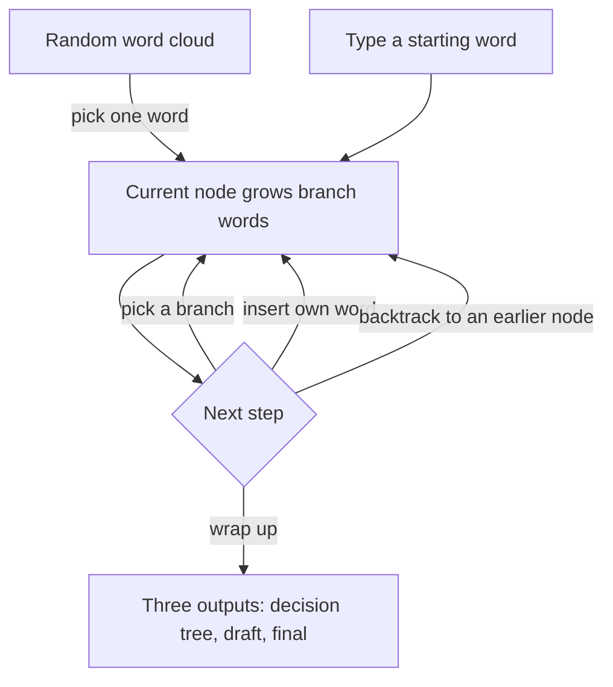

# Driftwords: A Thinking Workbench for Entropy Up and Entropy Down

Oct 24, 2026 · @Bill

## What it is

Driftwords is a thinking-exploration tool that runs in the browser. On an infinite desktop, the user makes one choice after another from words drifting in front of them, and the tool quietly organizes those choices in the background into a structured, cited document. "Driftwords" is a working title.

It is built for a particular state of mind: you want to do something but don't know what; you have a vague direction but can't untangle it; or you simply have brain fog and can't get into flow. In that state, a blank text box or a chat window doesn't help, because both demand that you first think the problem through. Driftwords works the other way around: it only asks the user to pick, from the few words in front of them, the one they find more interesting.

The whole process is an interplay between "entropy up" and "entropy down." The desktop handles entropy up: it keeps diverging, growing new words and surfacing new material. The sidebar handles entropy down: it organizes the path the user has walked into relationships, explanations, and conclusions. The user just chooses by intuition, and at the end walks away with three outputs: a decision tree, a full draft, and a final polished document.

The user never needs to talk to an AI or to anyone. Language models and web search are used in the background, but only to generate associated words, find sources, and write up text. They never appear in the foreground.

## Design principles

Every detail of the product follows from these five principles.

1. **Choose, don't chat.** Nearly all user input is clicking and selecting. The only typing happens when entering a starting word or inserting a word of one's own, and each time it must be a single word, never a sentence.
2. **Forced, finite choice.** Words on screen cannot be refreshed or rerolled. If infinite rerolls were allowed, users would keep randomizing forever and never commit. Only when these few words are all there is will users seriously compare them, and the act of comparing is itself how they sort out their own interests.
3. **Never interrupt exploration.** What happens on the desktop prioritizes protecting flow. The sidebar can be collapsed, sources appear asynchronously, and the user never has to wait for or confirm anything.
4. **Don't delete, strike through.** Ideas that were considered but not used stay in the record and can be restored at any time. The process of thinking is as valuable as its conclusions.
5. **Every connection has a source.** If the link between two words comes from a specific article, image, or piece of material, show it, and add it to a reference list in academic format.

## Interface and visual style

The interface has only two parts: an infinite workbench that fills the screen, and an organizing sidebar that can be collapsed and expanded. There is no fixed left/right split.

**Infinite workbench.** The desktop has no edges. When the user drags, they drag the entire workbench; the word tree and all source objects move together, and objects keep their position relative to the tree. Because positions are fixed, users can rely on spatial memory to return to earlier spots, like looking for something on their own desk.

**Organizing sidebar.** The sidebar is itself an "object" on the desktop. Click once to collapse it, click again to expand it, with a subtle physical feel to the animation. During exploration it can be fully collapsed so only the desktop is visible.

**Overall style.** It should feel like a 2D desktop workbench: things have positions and weight, they drop and float up, but nothing is realistic. The UI is modern and flat; overall it is a tool, not a game. The reference direction is the "desktop as workspace" feel of *Do Not Feed the Monkeys*, with its realistic textures removed and replaced by a flat icon style.

**Animation feel.** All transitions are non-linear and silky smooth, close to the quality of Apple system animations and vector animation. When a word is selected, the camera glides to it and new words grow out around it. The rhythm of the animation should make people want to keep clicking.

**Runtime.** Runs in the browser, and must support both desktop and mobile. Rendering uses a WebGL2- or WebGPU-class 2D engine to handle large numbers of objects drifting and moving at once.

## Exploration: the word tree on the desktop

There is only one basic action in exploration: pick one of the current words, and it becomes the new center and grows a ring of new words. Repeat, and the chosen words connect into a tree.

### Starting

When the tool opens, a cloud of random words drifts across the desktop. Each word is its own small tile, drifting very slowly. The word language is selectable, for example Chinese or English. This batch cannot be refreshed; the user must pick one of them.

If the user already has a vague direction, they can skip the word cloud and type a starting word to begin from there.

### Selection and branching

After the user clicks a word:

1. The other words dim but keep drifting.
2. The selected word enlarges slightly, and the camera glides smoothly onto it.
3. Like a mind map, it grows several branch words that slowly orbit around it. Branch words are random, but each is related to this word in some way.
4. The user picks one of the branches, and the process repeats indefinitely.

Because every step is a direction the user chose out of their own interest, the path itself is the thinking that is taking shape.

### When none of the branches fit

Branches cannot be regenerated, but at every step the user has two other options:

- **Insert their own word:** only a single word, never a sentence. It is inserted as a new node at the current position.
- **Wrap up:** see "Wrapping up and the three outputs" below.

### Backtracking

People don't always think linearly, so the user can click back to any previously chosen node in the tree and grow new branches from there. Revisited nodes tend to be subtopics within a larger theme, and when the final document is assembled, they naturally become subheadings.

### Divergence slider

The main interface has a divergence slider that controls how far new branch words are from the current word:

- **Low divergence:** branch words are closely related to the current word; good for going deep in one direction.
- **High divergence:** branch words jump further away, creating unexpected discoveries.

Divergence also determines the cap on repeated words; see the next section.

### Preventing loops

- **Words already chosen:** never appear as branches again.
- **Words that appeared but were not chosen:** may appear again, up to a limit. The limit is set by divergence: the higher the divergence, the lower the limit, so exploration spreads out faster.

## Source objects: provenance dropped on the desk

When the connection between two words has a concrete source, that material appears on the desktop as an "object," like a new document landing on the workbench. Not every connection gets an object; one appears naturally only when the background actually finds material.

**How they appear.** An object floats up from the background, or drops onto the desktop like a file, with a slight physical feel. It lands some distance behind its corresponding node, and may sit at an angle rather than perfectly aligned. Once landed, its position is fixed relative to the word tree.

**Appearance.** Similar to icons on a computer desktop, flat style, with a line of small text underneath saying what it is. Different types of material look different:

| Material type | How it looks on the desktop |
| --- | --- |
| Article, paper, PDF | File icon + title |
| Web page | Web card icon + site name |
| Image | Rendered directly as a small thumbnail |
| Audio, music | A small speaker player |

**Interaction.** Click once and the object floats to the foreground and enlarges. Click again to open the original material, i.e. the content the background relied on when making this association.

**Finding things again.** Users mainly find objects again by dragging the desktop and relying on spatial memory. The sidebar also maintains a list of all objects, but it is only a fallback entry point and must not visually steal attention.

**Latency isn't a problem.** Web search always has latency. But objects drop asynchronously: the user keeps choosing words, and a moment later a piece of material lands behind them. The delay becomes part of the rhythm.

## Organizing sidebar

The sidebar handles entropy down: it translates the path walked on the desktop into text, and lets the user decide which text matters.

**Content.** Each time the user picks a word, the sidebar adds an entry explaining how the previous word relates to this one and what role it plays, with a sentence or two of explanation. If the connection has a source object, the entry marks which material it cites.

**Priority.** Entries have multiple priority levels. When the user finds an entry interesting, they push it up; they can push it up several levels at once, with no upper limit.

**Strike through.** Unwanted entries are never deleted; they are shown struck through, like crossing out a line on paper. It means "I thought of this, but I'm not using it right now." Struck entries are kept and can be pushed back up later. Strike-through, like wrap-up, is an explicit button.

**Reference list.** All cited materials are automatically added to a reference list in academic format, written rigorously enough to be used directly in formal writing.

**Source list.** The sidebar also holds a list of all source objects on the desktop, as a fallback for when the user can't find something on the desktop. Its position and visual weight are lower than the main entries.

**Timing.** The sidebar updates continuously in the background but never pops up on its own to interrupt the user. It opens only when the user wants to look.

## Wrapping up and the three outputs

Wrap-up is an explicit button. When the user feels they've gone far enough, they press it, and the background starts converging the divergent content, ultimately producing three outputs.

| Output | Content | References |
| --- | --- | --- |
| Decision tree | How the user got here step by step, including every fork and backtrack | None |
| Draft | Everything in the sidebar, including low-priority and struck-through entries; a complete record of the thinking | Full list, including sources cited by struck-through entries |
| Final | Only high-priority content, reorganized into a coherent document; backtracked nodes can serve as section structure | Only sources actually cited in the final |

The draft and final reference lists will differ: once an entry is struck through, any source it cites is excluded from the final list unless some other retained entry also cites it.

Outputs default to Markdown and can also be exported to other formats. Users may arrive not knowing what they want to do, and leave with an introductory note on a new concept, a project direction, or a plan of work.

## The flow of one exploration

Two ways to start, four next steps:

Picking a branch, inserting a word, and backtracking all return to the same loop; only pressing wrap-up leaves it. Source objects and sidebar entries appear asynchronously in the background and never make the loop stop and wait.

## Data structures and backend

In data terms, one exploration is a tree plus a few auxiliary tables; every animation in the foreground is a visualization of this data.

| Structure | What it stores | Purpose |
| --- | --- | --- |
| Word tree | Each chosen node, its parent, selection order, whether it has been revisited | Generates the decision tree; revisited nodes provide sections for the final |
| Visited set | Every word that has been chosen | Chosen words never reappear; same idea as the visited set in DFS/BFS |
| Appearance counts | Each word that appeared but wasn't chosen, and how many times it appeared | Works with the divergence-based cap to prevent loops |
| Sources | Each source object: type, origin, the connection it belongs to, position and angle relative to the word tree | Desktop rendering; sidebar fallback list |
| Entries | Each relationship note, its priority, whether it's struck through, which sources it cites | Sidebar display; draft and final |
| References | Academic-format entry for each source, and the entries citing it | Draft takes all; final takes only those cited by retained entries |

**Three background jobs.** The backend uses a language model that doesn't need to be very smart (it can be a local model), together with web search, to do three things:

1. **Generate branch words:** produce candidate words from the current word, the path context, and the divergence setting, then filter them against the visited set and appearance counts. This step must be fast, since it affects the feel of the animation.
2. **Find sources:** search the web for articles, images, audio, and other material for each new connection. Runs asynchronously; if something is found, an object drops onto the desktop, and if not, nothing is shown.
3. **Write the organizing text:** write each relationship note and short explanation, and at wrap-up, assemble the high-priority content into the final document. Also asynchronous.

Only the first job is on the user's interaction path. The other two queue in the background, and the user never feels they are waiting on them.

## Open questions

The core concept is complete. These details still need to be settled before design and implementation.

- [ ] Can source objects be dragged from the desktop into the sidebar and manually bound to an entry as a citation?
- [ ] How many branch words grow per ring? How many words are in the initial cloud? Are these numbers also tied to divergence?
- [ ] Where do the initial random words come from: drawn from a fixed word bank, or generated by the model each time?
- [ ] Does inserting one's own word count only as a node, or does it also make that word grow branches?
- [ ] Can an exploration be saved and resumed? Is a desktop one-shot, or can the user come back the next day and continue?
- [ ] What state is the desktop in after wrap-up: frozen read-only, or can it be reopened to continue exploring?
- [ ] Phones lack the width for a sidebar. Does it become a bottom drawer or a full-screen toggle on mobile?
- [ ] Which reference format: APA, IEEE, or user-selectable?
- [ ] Product name.
